# 👋 Hi there, I'm Shameer Babu

### Flutter Developer · Mobile App Engineer · Problem Solver 🇮🇳

Building beautiful, scalable, and user-focused mobile applications with Flutter.

---

## 💫 About Me

- 🔭 **Currently working on:** Manara (منارة), a UAE educational platform
- 📱 **Main focus:** Flutter, Dart, and BLoC state management
- 🏗️ **Architecture:** Clean Architecture and feature-based structure
- ⚙️ **Experience:** REST API integration, Firebase, Node.js, and MongoDB
- 🌐 **Interested in:** Localization, accessible UI, and reliable mobile experiences
- 💬 Ask me about **Flutter and mobile app development**
- 📫 **Email:** [srbshameer098@gmail.com](mailto:srbshameer098@gmail.com)
- 📍 **Location:** India

## 🧰 Tech Stack

### Mobile Development

### Backend & Database

### Tools

---

## 🚀 Featured Projects

### 🎓 Manara (منارة) — UAE Educational Platform

A bilingual Flutter application that helps parents and students in the UAE discover, compare, and connect with schools, nurseries, and universities across all seven Emirates.

- 🏫 Institution discovery with search and filters for location, curriculum, and fees
- ⚖️ Compare up to three schools across key criteria
- 📅 Book campus tours and track application status
- ✉️ Submit school enquiries and track their progress
- 👨‍👩‍👧 Parent authentication and multiple child profiles
- 🌐 English and Arabic localization with right-to-left (RTL) layout support
- ☁️ Cloud-synchronized institution shortlists

**Tech:** Flutter · Dart · BLoC · Clean Architecture · REST APIs · Localization

### 🏢 Onlypass

A membership management application for gyms, co-working spaces, and study spaces.

- Member and enquiry management
- Attendance and payment management
- Biometric attendance integration

**Tech:** Flutter · Dart · BLoC

### 📒 Kanakk Book

A personal accounting and bookkeeping app for managing everyday transactions.

- Transaction tracking and reports
- Backup and restore functionality
- Premium features

**Tech:** Flutter · Dart · Hive

### 🚘 Vehiclix

A vehicle inspection application built to support inspection workflows.

- Vehicle inspection workflows
- Flutter mobile application
- Node.js/Express backend and MongoDB
- React dashboard

**Tech:** Flutter · BLoC · Node.js · MongoDB · React

> Project details are summarized for portfolio purposes. Only share company or team project information that you're authorized to disclose.

---

## 📊 GitHub Analytics

 

## 🏆 GitHub Trophies

## 🏅 Profile Badges

## 📅 Contribution Activity

'''

### 💚 Building useful things, one commit at a time.

*Thanks for visiting my profile!*

